# Hi, I'm Yumnam Momojit Singh 👋

### Assistant Professor & AI Researcher • Agentic AI Builder • PhD Scholar

**Centre of Artificial Intelligence, Indira University, Pune, India**

I work at the intersection of AI research, cloud engineering, and education — building intelligent systems, agentic workflows, and practical learning experiences.

[LinkedIn](https://www.linkedin.com/in/yumnam-momojit-singh-60b4aa1a4/) • [Portfolio](https://yumnammomojit.semdok.com/) • [GitHub](https://github.com/YumnamMomojit) • [Email](mailto:yumnammomojit7@gmail.com)

---

## About Me

- 🎓 Assistant Professor & Researcher at the Centre of Artificial Intelligence, Indira University, Pune
- 🤖 Exploring and building **Agentic AI**, **RAG**, **Deep Learning**, and **MLOps** systems
- ☁️ Strong foundation in **AWS, DevOps, CI/CD, Terraform, Linux, and cloud architecture**
- 🧑‍🏫 Educator and mentor with experience training 590+ learners and supporting student growth
- 🏅 AWS Certified Educator and IndiaSkills 2025 Cloud Computing jury member
- 📍 Based in Pune, India; originally from Thoubal, Manipur

## Current Focus

- Building AI-powered and agentic applications for real-world use
- Designing and deploying cloud-native learning and research projects
- Creating practical, hands-on AI and cloud experiences for learners
- Exploring research collaborations in ML, AI, and intelligent systems

## Tech Stack

**AI / ML:** Agentic AI • RAG • Deep Learning • Machine Learning • LangChain • TensorFlow • Keras • Scikit-learn  
**Cloud / DevOps:** AWS • Docker • Terraform • OpenStack • CI/CD • Linux • Azure  
**Development:** Python • JavaScript • TypeScript • React • Node.js • REST APIs • MongoDB

## Featured Projects

- [Myportfolio](https://github.com/YumnamMomojit/Myportfolio) — interactive 3D portfolio and learning platform
- [CARE-RAG](https://github.com/YumnamMomojit/CARE-RAG) — comparative analysis of RAG approaches
- [RAGresearch](https://github.com/YumnamMomojit/RAGresearch) — research and experiments in RAG
- [AWS](https://github.com/YumnamMomojit/AWS) — AWS learning and practical notes
- [Elysia-AI](https://github.com/YumnamMomojit/Elysia-AI) — AI-based conversational experience
- [videomaker](https://github.com/YumnamMomojit/videomaker) — AI and media tooling project

## Collaboration

I’m open to collaborating on:
- AI and GenAI projects
- Agentic AI / LLM application development
- Cloud and DevOps solutions
- Python-based AI research and product prototypes
- Educational and research-oriented AI initiatives

## Connect

- 💼 [LinkedIn](https://www.linkedin.com/in/yumnam-momojit-singh-60b4aa1a4/)
- 🌐 [Portfolio](https://yumnammomojit.semdok.com/)
- 📧 [yumnammomojit7@gmail.com](mailto:yumnammomojit7@gmail.com)
- 💻 [GitHub](https://github.com/YumnamMomojit)

<!---
YumnamMomojit/YumnamMomojit is a ✨ special ✨ repository because its `README.md` (this file) appears on your GitHub profile.
You can click the Preview link to take a look at your changes.
--->
